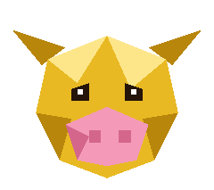

<p align="center"></p>

# niu-lai-viz

grafana for experiments · weights & biases for the poor · 100% /metrics

Scrapes Prometheus `/metrics` endpoints into Parquet runs and serves a live UI to compare them.


https://github.com/user-attachments/assets/162efd4e-8f4f-49e2-92f7-8108bd38138a


## Demo

Needs Rust ([rustup](https://rustup.rs)) and Python 3.

```bash
git clone https://github.com/Aphoh/niu-lai-viz && cd niu-lai-viz
cargo build --release
python3 examples/demo.py --bin target/release/niu-lai-viz --root runs
```

Then open the printed link (http://127.0.0.1:8737). Ctrl+C stops it.

## Scrape your own job

Your job just needs a Prometheus `/metrics` endpoint (e.g. `prometheus_client.start_http_server(8000)` in Python; vLLM, SGLang, DCGM and node exporters already have one). Then, one scraper per experiment and one viewer for all of them:

```bash
# terminal 1: scrape until Ctrl+C (or SIGTERM), then compact the run into runs/my-exp/final.parquet
target/release/niu-lai-viz scrape --root runs --run my-exp \
  --target trainer=http://localhost:8000/metrics \
  --label lr=3e-4 --label model=qwen3-8b

# terminal 2: the viewer; picks up new and live runs by itself
target/release/niu-lai-viz serve --root runs   # http://127.0.0.1:8737
```

- `--target NAME=URL` is repeatable (e.g. trainer + DCGM on the same run). Series are keyed `NAME/metric{labels}`. Scrape every `--interval-ms` (default 1000).
- `--label KEY=VALUE` is repeatable: experiment parameters, shown under each run and filterable (`lr=3e-4`).
- A taken `--run` name gets a `-2`, `-3`... suffix. While scraping, the run is flock'd (`runs/<run>/.lock`) so nothing else writes it. A killed scraper shows as `stale`; `niu-lai-viz compact runs/<run>` finishes it.
- `--config file.toml` adds per-target rules: `include`/`exclude` regexes, `strip_prefix`, `rename`, `drop_labels`, `label_columns`, run labels. See [`examples/dcgm.toml`](examples/dcgm.toml), [`examples/node-exporter.toml`](examples/node-exporter.toml), [`examples/demo.toml`](examples/demo.toml).

```toml
# my-job.toml:  niu-lai-viz scrape --config my-job.toml --run my-exp
[run]
labels = { model = "qwen3-8b", lr = "3e-4" }

[[targets]]
name = "trainer"
url = "http://localhost:8000/metrics"
interval_ms = 1000
exclude = ["^python_", "^process_"]
```

## Dashboards

The header's dashboard menu saves the current charts, formulas, axis settings, T=0 and picked runs as a named dashboard in `<root>/.dashboards/`. Anyone using the same `serve` sees it, and `http://host:8737/?d=<name>` (the `link` button) opens it. Saves are versioned: if someone else saved the same dashboard since you loaded it, you're asked before overwriting.

A dashboard also saves its chart notes (markdown under a chart title: click `✎` to write one, or the agent pins its conclusions there with `set_chart_note`) and the last 200 chat messages, so opening the link restores the conversation and you can carry on asking.

